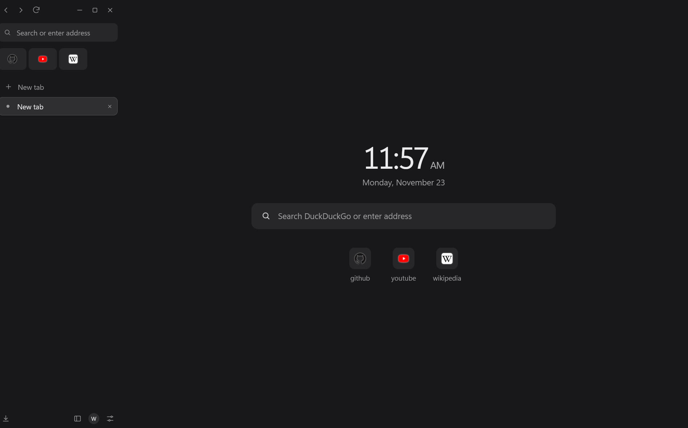

<div align="center">


# Velocity

A fast, light desktop browser for Windows, built on its own Servo engine.

[](LICENSE)
[](#building-from-source)
[](https://www.rust-lang.org)
[](https://github.com/MrKniha/velocity-engine)

[Features](#features) · [Building from source](#building-from-source) · [Memory use](#memory-use) · [Contributing](#contributing) · [License](#license)

<br>



</div>

Velocity renders every page with a patched build of [Servo](https://servo.org), the web engine written in Rust. Its own tabs, new tab page and settings are web pages on the same engine. There is no Chromium, WebView2 or other system web runtime inside.

The aim is a browser that opens quickly, stays light on memory while you work, and lets you change how it looks and behaves from its settings page instead of config files.

> [!WARNING]
> Velocity is early software and has no release yet. Servo does not render every site correctly, and settings and data formats can still change.

## Features

### Interface

- Vertical tabs in a sidebar, on the left or right, with Essentials for the sites you keep open.
- Compact mode hides the sidebar until the mouse reaches the window edge.
- A new tab page with a clock, search and your own background image or video. Wallpaper Engine backgrounds can be imported.
- Dark and light themes, an accent color, and adjustable sidebar width, page spacing and corner radius.

### Privacy and security

- Ads and trackers are blocked with the rulesets of [uBlock Origin Lite](https://github.com/uBlockOrigin/uBOL-home), applied in the engine's network layer. Empty ad boxes are hidden as well.
- Web pages run in separate content processes. Velocity locks each one down with its own Windows sandbox before the process receives a page.
- Velocity's own pages load no remote fonts, images or scripts.

### Everyday browsing

- Profiles, each in its own window with separate settings, history, cookies and site data.
- History, downloads, and import of history, bookmarks and Firefox cookies from the browsers already on your PC.
- Protected video (EME with PlayReady through Windows Media Foundation), so streaming services such as Netflix can play.
- Updates from this repository's GitHub Releases. Each installer is checked against its published SHA-256 before it runs.

## Building from source

Velocity builds on Windows 10 or 11, x64.

### Requirements

- [Rust](https://rustup.rs) (stable, MSVC toolchain) and the Visual Studio C++ build tools
- Python with libclang: `pip install libclang`
- GStreamer, for audio and video: `winget install gstreamerproject.gstreamer`

### Build

Clone this repository and [velocity-engine](https://github.com/MrKniha/velocity-engine) side by side, then run the build script:

```powershell
git clone https://github.com/MrKniha/velocity.git
git clone https://github.com/MrKniha/velocity-engine.git
cd velocity
powershell -File scripts\build.ps1
```

You get `target\release\velocity.exe` with the DLLs the engine needs (ANGLE and GStreamer) next to it. The first build compiles all of Servo and takes a while. A rebuild after an engine change takes about five minutes.

### Package

`scripts\package.ps1` builds a portable zip and, when [Inno Setup](https://jrsoftware.org/isinfo.php) is installed, an installer. It bundles uBlock Origin Lite from `%LOCALAPPDATA%\velocity\extensions\uBOLite` by default; pass `-Ubo <folder>` to use another copy.

## Memory use

Memory is measured with the scripts in [`bench/`](bench), which count the whole process tree (browser, page and GPU helper processes) on a hidden desktop. Numbers below are private memory from `bench/memory.ps1` with uBlock Origin Lite loaded, on local test pages:

| Scenario | Private memory |
|---|---|
| New tab page, idle | 90 MiB |
| 10 tabs | 386 MiB |
| 30 navigations in one tab | 170 MiB |

Real sites use much more. Ten popular sites open as tabs take about 2.2 GB, and github.com alone takes about 1 GB in its page process. `bench/realsites.ps1` measures that case, and every recorded run is in [`bench/results/`](bench/results).

## Repository layout

| Path | Contents |
|---|---|
| [`src/`](src) | The browser: window, tab UI, settings, profiles, downloads, sandbox, media and updates |
| [`src/pages/`](src/pages) | Velocity's own pages (new tab, settings, sidebar, profile picker) |
| [`bench/`](bench) | Memory, speed and real-site benchmarks and their results |
| [`scripts/`](scripts) | Build and packaging scripts |
| [`installer/`](installer) | Inno Setup script for the installer |

The engine, with the patched Servo crates and a list of every patch and the reason for it, lives in [velocity-engine](https://github.com/MrKniha/velocity-engine).

## Contributing

Bug reports and pull requests are welcome.

- For a page that renders wrong, include the URL and a screenshot.
- For a change that affects memory or speed, include before and after numbers from the `bench/` scripts.
- Engine changes go to [velocity-engine](https://github.com/MrKniha/velocity-engine), marked `velocity patch` in the source and listed in its `vendor/README.md`.

## License

Velocity is licensed under the [Mozilla Public License 2.0](LICENSE), the same license as Servo.

Release packages include third-party software under its own license: Servo (MPL-2.0), uBlock Origin Lite (GPL-3.0), GStreamer and FFmpeg (LGPL-2.1 or later), and ANGLE (BSD-3-Clause). `scripts\package.ps1` writes these notices into every package.

## Acknowledgements

Velocity exists because of [Servo](https://servo.org) and the people who build it, and it blocks ads with the work of [Raymond Hill](https://github.com/gorhill) and the uBlock Origin Lite project.
